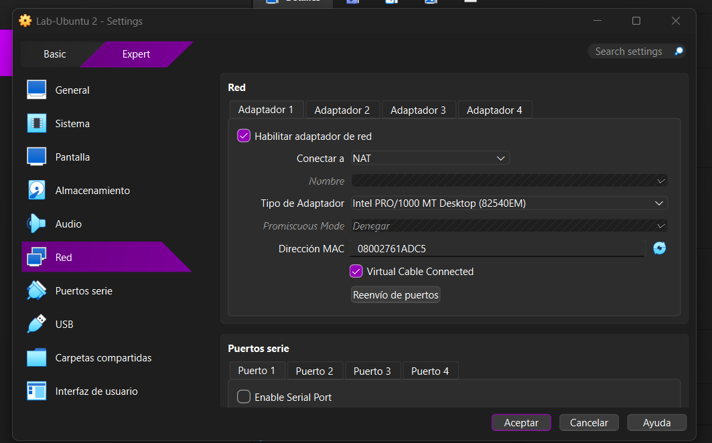
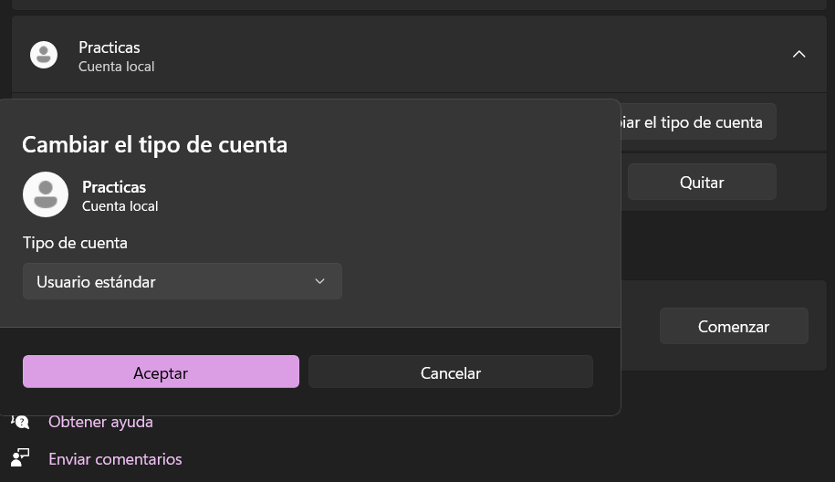
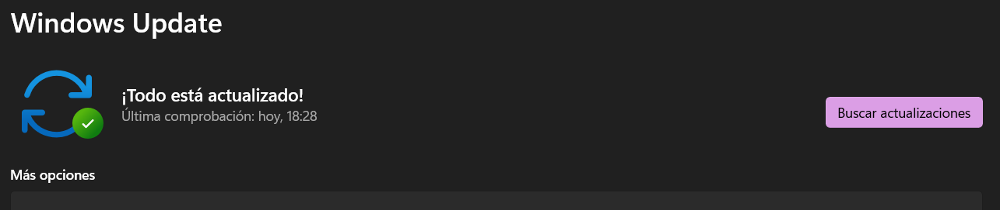
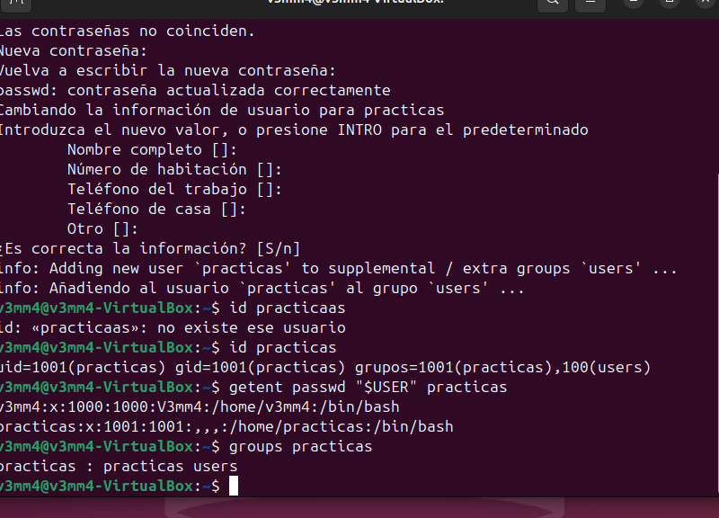
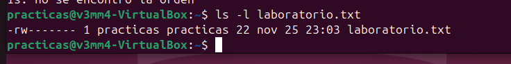
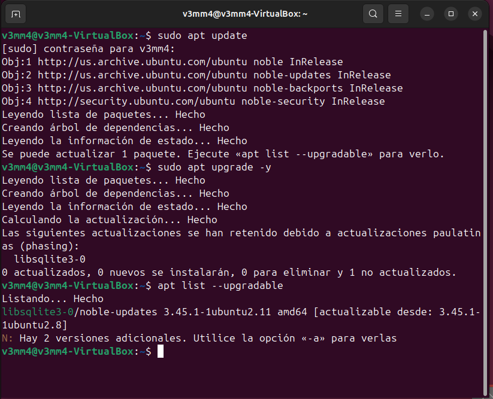
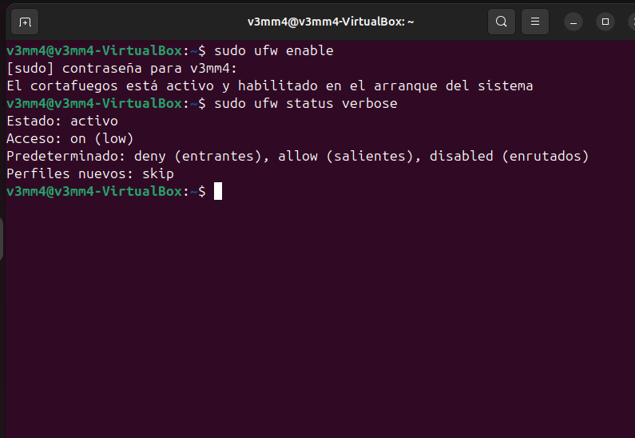

# Checkpoint: Mi primer laboratorio seguro de ciberseguridad

## Reporte Técnico de Configuración de Laboratorio

## 1. Introducción

El objetivo de este trabajo es construir un laboratorio
seguro de ciberseguridad mediante la virtualización y la
aplicación de técnicas básicas de Hardening, reduciendo
los riesgos para el equipo anfitrión.

## 2. Configuración del laboratorio

| Componente | Configuración |
|---|---|
| Hipervisor | Oracle VirtualBox 7.2.22 |
| Máquina virtual | Lab-Ubuntu 2 |
| Sistema anfitrión | Windows 11 |
| Sistema invitado | Ubuntu 24.04 LTS |
| Memoria RAM | 4096 MB |
| Procesadores | 2 |
| Disco virtual | 25 GB |
| Guest Additions | Instaladas |

Se reutilizó la máquina virtual del ejercicio anterior.
Se aumentó la memoria RAM de 2 GB a 4 GB para facilitar
la instalación y mejorar el rendimiento.

## 3. Fundación: VirtualBox y red aislada

Se configuró el adaptador de red en modo NAT para permitir
la descarga de actualizaciones sin exponer directamente
la máquina virtual a la red doméstica.

No se utilizó el modo Adaptador Puente (Bridged), debido
a que aumenta la exposición de la máquina virtual.

### Evidencia



## 4. Capa Windows: Usuarios y actualizaciones

### 4.1. Creación de un usuario estándar

En el sistema anfitrión Windows 11 se creó una cuenta
local llamada Practicas con permisos de usuario estándar.

Esta configuración aplica el principio de mínimo privilegio,
evitando que las tareas cotidianas se realicen con permisos
administrativos innecesarios.



### 4.2. Windows Update

Se verificó el estado de las actualizaciones de Windows.
El sistema indicó que estaba completamente actualizado
al momento de realizar la comprobación.



## 5. Capa Linux: Permisos y gestión

### 5.1. Creación de un usuario limitado

Se creó el usuario practicas mediante el comando:

```bash
sudo adduser practicas
```

Se verificaron sus grupos y permisos utilizando:

```bash
id practicas
groups practicas
getent passwd "$USER" practicas
```

El usuario no pertenece al grupo sudo, por lo que no
dispone de privilegios administrativos.



### 5.2. Permisos de archivos

Se creó un archivo llamado laboratorio.txt y se
configuraron sus permisos mediante los comandos:

```bash
touch laboratorio.txt
echo "Mi laboratorio seguro" > laboratorio.txt
chmod 600 laboratorio.txt
ls -l laboratorio.txt
```

Los permisos obtenidos fueron:

`-rw-------`

Esto significa que únicamente el propietario tiene
permisos de lectura y escritura. El grupo y los demás
usuarios no tienen acceso al archivo.



### 5.3. Gestión de actualizaciones

Se utilizaron los siguientes comandos para comprobar
e instalar las actualizaciones disponibles:

```bash
sudo apt update
sudo apt upgrade -y
apt list --upgradable
```

Se comprobó correctamente el estado de los paquetes.
El paquete libsqlite3-0 quedó pendiente debido al
mecanismo de distribución gradual de actualizaciones
de Ubuntu (phasing).



## 6. Hardening básico: Configuración del firewall

Como medida adicional de seguridad, se activó el
cortafuegos UFW mediante los comandos:

```bash
sudo ufw enable
sudo ufw status verbose
```

El firewall quedó activo y habilitado al inicio del
sistema, denegando por defecto las conexiones entrantes
y permitiendo las conexiones salientes.



## 7. Red de seguridad: Snapshots

Se crearon dos instantáneas de seguridad:

- Clean Install - Hardening applied
- Hardening inicial

Estas instantáneas permiten recuperar el estado del
laboratorio después de aplicar las medidas de seguridad,
sin necesidad de reinstalar el sistema operativo.

También se conservó la instantánea anterior denominada
Instalación Base Limpia.


## 8. Evidencia adicional de seguridad

Se intentó ejecutar un comando administrativo desde
el usuario practicas.

El sistema rechazó la solicitud indicando que el
usuario no pertenece al archivo sudoers.

Esto demuestra que la separación de privilegios
funciona correctamente.


## 9. Dificultades y soluciones

Durante las prácticas se presentaron dificultades
de conectividad debido a la configuración de Red Interna,
que impide el acceso directo a Internet.


El problema se solucionó cambiando temporalmente
la configuración de red a NAT para permitir la
descarga de actualizaciones.

También se presentaron problemas de rendimiento durante
la instalación inicial de Ubuntu, que se abordaron
utilizando Ubuntu 24.04 LTS y aumentando la memoria
asignada a 4 GB.

## 10. Conclusión

Durante este Checkpoint aprendí a configurar un
laboratorio virtual y aplicar medidas básicas de
seguridad, incluyendo:

- Virtualización y aislamiento de red.
- Creación de usuarios con permisos limitados.
- Principio de mínimo privilegio.
- Gestión de permisos en Linux.
- Actualización de sistemas operativos.
- Configuración del firewall.
- Creación de instantáneas de recuperación.

Estas medidas constituyen una base fundamental para
realizar futuras prácticas de ciberseguridad en un
entorno controlado.

---

**Autor:** v3mm4
